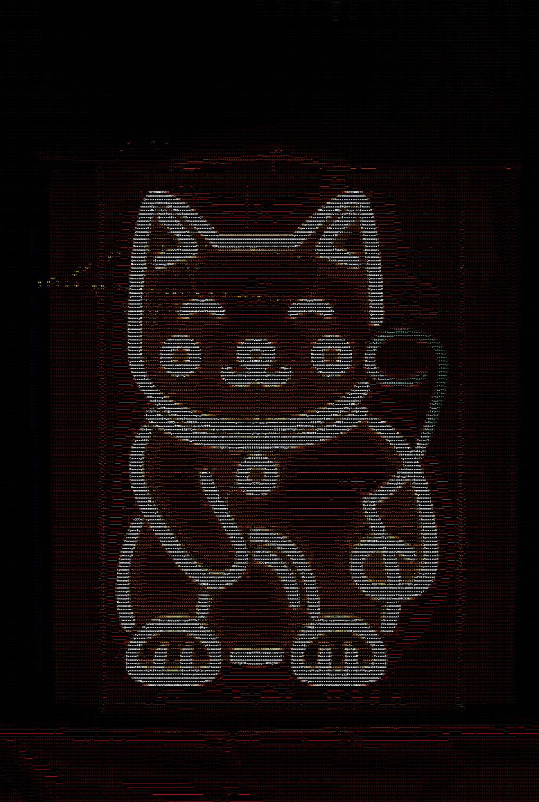

VYXORDEV PRESENTS · AN INDEPENDENT DIGITAL ART GALLERY

# ASCII / GALLERY

**Characters are the brush. Pixels are the canvas.**

A curated collection of character-built artwork, preserved as high-resolution PNGs.  
From dramatic black-and-white compositions to vivid full-colour pieces.

  
  
  

<a href="#on-display">ON DISPLAY</a> &nbsp;·&nbsp;
<a href="#source-credits--usage-rights">RIGHTS</a>

---

## On display

THE PERMANENT COLLECTION · 03 ARTWORKS

### EXHIBIT 003 / CYBERPUNK CHINESE

**CHROMA · COLOURED ASCII · 003**

*A neon-soaked nighttime scene reimagined in fine, luminous characters.*

<a href="./gallery/colour/CyberpunkChinese.png"><strong>Explore this artwork at full resolution</strong></a>

---

### Explore the exhibits

<table>
  <tr>
    <td width="33%" align="center" valign="top">
      
       
      <strong>001 / Jet Roars Over Empty Beach</strong> 
      CHROMA · COLOURED ASCII
    </td>
    <td width="33%" align="center" valign="top">
      
       
      <strong>002 / Neon Kitty</strong> 
      CHROMA · COLOURED ASCII
    </td>
    <td width="34%" align="center" valign="top">
      
       
      <strong>003 / Cyberpunk Chinese</strong> 
      CHROMA · COLOURED ASCII
    </td>
  </tr>
</table>

## The gallery standard

- **Visual art only.** Gallery exhibits are rendered **PNG images**, not text files or terminal dumps.
- **Two curated rooms.** Monochrome and coloured work are kept separate.
- **Detail first.** Typography, contrast, composition and legibility define the collection.
- **Full resolution.** Select any preview to open the original uploaded artwork.
- **Rights-aware curation.** Source information and permissions are recorded where known.

## Viewing guide

Open an exhibit to view its full-resolution image. Intricate ASCII textures are easiest to appreciate when zoomed in.

<strong>What is character-built art?</strong>

 

ASCII art creates images through the arrangement of text characters. The gallery exhibits rendered PNGs so that the compositions preserve their proportions and colours without depending on terminal fonts or column widths.

## Source credits & usage rights

Some exhibits are converted from third-party images. **Converting a photo into ASCII does not automatically remove the source photographer's rights.**

Exhibits 002 and 003 were reported as sourced from Unsplash; individual photo links and creators have not been verified. Consult [SOURCES.md](./SOURCES.md) for the source register. No blanket license is granted over third-party works. See [LICENSE](./LICENSE).

---

EST. 2026 · CREATED & CURATED BY <a href="https://github.com/VyxorDev">VYXORDEV</a>

**Less noise. More art.**

