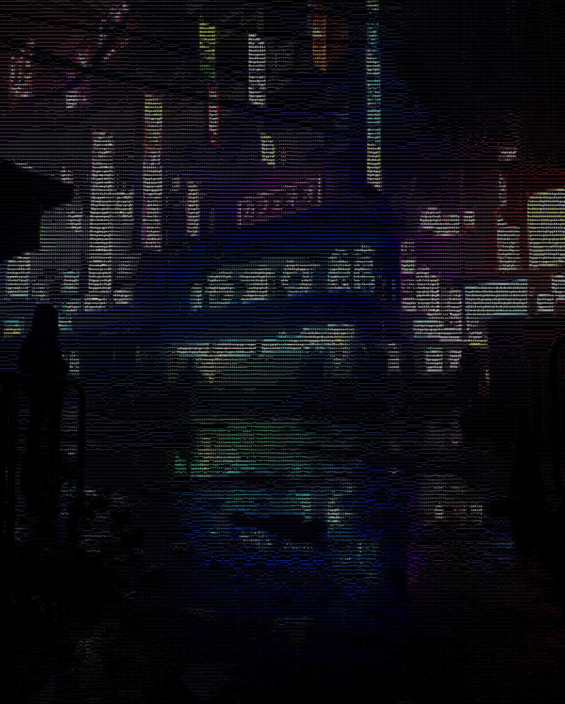
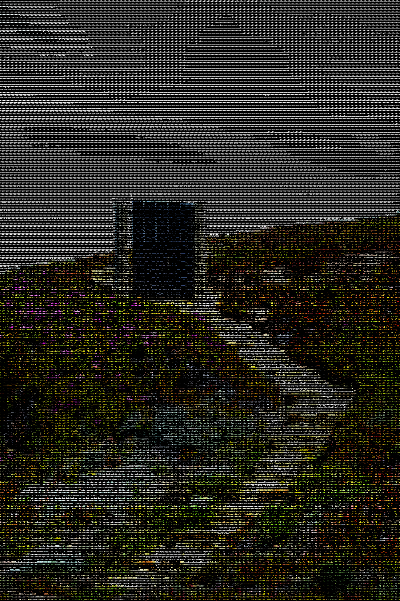

# ASCII Gallery

Images recreated with text, in colour and monochrome.

<table>
  <tr>
    <td align="center" width="50%">
      
       <strong>01 — Jet Roars Over Empty Beach</strong>
    </td>
    <td align="center" width="50%">
      
       <strong>02 — Neon Kitty</strong>
    </td>
  </tr>
  <tr>
    <td align="center" width="50%">
      
       <strong>03 — Cyberpunk Chinese</strong>
    </td>
    <td align="center" width="50%">
      
       <strong>04 — Buildings</strong>
    </td>
  </tr>
  <tr>
    <td align="center" width="50%">
      
       <strong>05 — Alone</strong>
    </td>
    <td align="center" width="50%">
      
       <strong>06 — Stormwatch</strong>
    </td>
  </tr>
  <tr>
    <td align="center" colspan="2">
      
       <strong>07 — Blue Phantom</strong>
    </td>
  </tr>
</table>

[Browse PNGs](./gallery/colour/) · [Image sources & rights](./SOURCES.md) · [License](./LICENSE)

ASCII conversions by <a href="https://github.com/VyxorDev">VyxorDev</a>. Original images may belong to their respective creators.

